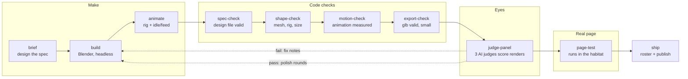

# Pipeline map

One page to see how a model goes from idea to the habitat. Keep it in step with the skills (`.claude/skills/`) when a step is renamed.

| Stage | Skill / tool | What it decides |
|---|---|---|
| brief | creature-brief, plant-brief, scenery-make | what to make (species, palette, motion) |
| build, animate | model-build, creature-animate, plant-grow | the .glb |
| spec-check | `shared/tools/check_spec.py` | the design file is complete and in range |
| shape-check | `shared/blender/qa_structural.py` + `<kind>/qa.py` | triangles, bones, weights, size, rest pose |
| motion-check | same | loops close, motion big enough, feed action exists |
| export-check | `shared/tools/verify.sh` | glb passes the validator, file small enough |
| judge-panel | model-verify (3 fresh AI judges) | looks, style, flaws, readable motion, mouth |
| page-test | model-verify | works in the real habitat/garden page |
| ship | model-ship | roster entry, published board |

Judge-panel scores per kind: creature = species read, anatomy, style match, artifacts, idle readable, feed readable, mouth; plant = same plus growth, sway, tend readable; scenery = reads as, style match, artifacts, sway readable. Bars live in `<kind>/qa_calibration.json`.

Run budget (builds, minutes, judges) is tracked by `shared/tools/ledger.py`.
