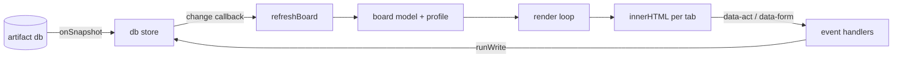

# Board UI (`ui` package)

`src/packages/ui` is the only DOM-heavy layer on top of the domain packages. The page entry `src/main.ts` calls `bootBoard()` and nothing else; every other package is reached through the `ui` folders below. Terms such as *board model*, *view state*, *run write* and *redraw registry* are defined in [GLOSSARY.md](../../GLOSSARY.md).

## Layout

| Folder / file | Role |
|---|---|
| `boot.ts` | `bootBoard`: wires the renderer, events, theme, db store and calendar |
| `board-model.ts` | Pure `buildBoardModel`: store docs in, everything the views read out |
| `shared/state.ts` | The singleton `store`, the `model` and `profile` objects, and `viewState` |
| `shared/refresh.ts` | `refreshBoard`: rebuild model and profile from the store |
| `shared/redraw.ts` | `render` / `scheduleRender` / `catchUp` registry |
| `shared/writes.ts` | `runWrite`, undo toasts, task bodies and recurring successors |
| `app/` | render loop, the delegated event handlers, navigation, drag-to-reorder |
| `today/`, `plan/`, `lists/`, `life/`, `grow/` | one view per tab |
| `sheet/` | the add/edit sheet and the per-task chat |
| `game/` | on-demand game hooks and lessons |

## Boot sequence

`bootBoard` registers the renderer, attaches events, applies a saved theme, reads the URL hash, and starts the db store with a change callback. On every store change the callback runs `refreshBoard()`; once the store is `ready` it also seeds starter tasks, spawns missing recurring successors and records commitments, then schedules a redraw. It then starts the live calendar and listens for break-overlay events (see [Break overlay app](../integrations/break-overlay.md)).

## Data flow: db change to redraw

- The page talks to the artifact db only through the `use('db')` capability of the claude.ai runtime; `useDb` returns `null` outside claude.ai, which the store reports as status `nodb` (see [Data layer](./data-layer.md)).
- `refreshBoard` applies board prefs, reads the week start from `checks/week_start` (default Monday), switches the time zone from `checks/profile`, copies the profile, and replaces `model` in place with `buildBoardModel(store.all, …)`. Because it mutates the same exported objects, importers always see the latest model, and `modelRevision.count` increments so derived values (the game state) know to recompute.
- `buildBoardModel` is pure: today, week start and pets are passed in, it never reads the DOM or the clock. Views read the model; actions write through the store and never touch it.
- A habit session counts only if it was logged during its own week or carries a valid exception (reason plus evidence); the rest land in `voidHabitSessions`.

## Rendering

`app/render.ts` registers itself with `shared/redraw.ts`, so any module can ask for a redraw without importing the render loop (this avoids import cycles). Each render rebuilds the tab bar and replaces `#main`'s `innerHTML` with the current tab's view string, then restores the focused control by its `data-act`/`data-id`/`data-val` key and the scroll position. If the store is not `ready`, a status view (no data, lost connection, slow, loading) replaces the tab content instead of showing placeholder data.

`scheduleRender` coalesces redraws on a 16 ms timer and skips drawing while the user is typing or dragging; `catchUp()` schedules the skipped draw afterwards. db changes can arrive from other devices at any time, which is why a redraw must never clobber an in-progress edit. A render also detects a day rollover (`todayDate()` differs from `clock.today`) and refreshes the model and commitments.

## Events

`app/events.ts` installs one listener per event type. Controls carry `data-act` (clicks), `data-form` (submits) or a name the sheet watches, and a large `switch` on `data-act` dispatches them. Escape closes the popover, then the sheet, then the ring task list; Tab is trapped inside an open sheet. Drag-to-reorder uses pointer events and saves the bucket order on drop.

## Writes and undo

All UI writes go through `runWrite(write, message)`. It refuses (with a toast) when no db is connected, hands the write an `UndoRecord`, reports failures through `showSaveError` (quota, invalid doc, or generic), and shows a toast whose Undo calls `store.undo(rec)`. Recurring tasks use `spawnSuccessor`: completing a task creates its next occurrence once and marks the parent `recurrence_spawned`. Rules for computing the next date live in [Domain logic](./domain-logic.md).

## Game modules on demand

The `garden` and `ecosystem` packages are dynamically imported by `loadGameModules` only when the game is on, so they ship as separate chunks (see [Build and bundle](./build-and-bundle.md)). `loadGameModulesOnce` memoizes the load and clears the memo on failure so a later call can retry. `currentGame()` derives the game state from the model with `deriveGame`, caching by model revision and plant-pool version; it returns `null` until the game start day (`game_state/game`) is known, and writes that start day once rather than overwriting an existing one. After each render, `afterRenderGame` mounts the Ecosystem card, passes it state and weather, records the week's visitor, and writes `checks/game_status` (only when it changes) so the weekly agent can see the biome, phase and plots needing models (see [Publishing and the weekly run](../operations/publish-and-weekly-run.md) and [Game derivation](../game/game-derivation.md)).

## Extending

- A new view or action: add a `data-act` case in `app/events.ts` and write through `runWrite`; add the data to `buildBoardModel` rather than reading the store in a view.
- Keep `board-model.ts` free of DOM and clock access; boundaries are enforced by [package boundaries](./package-boundaries.md).
- Tests for pure UI logic sit in `src/packages/ui/tests/` and import only entry points.
