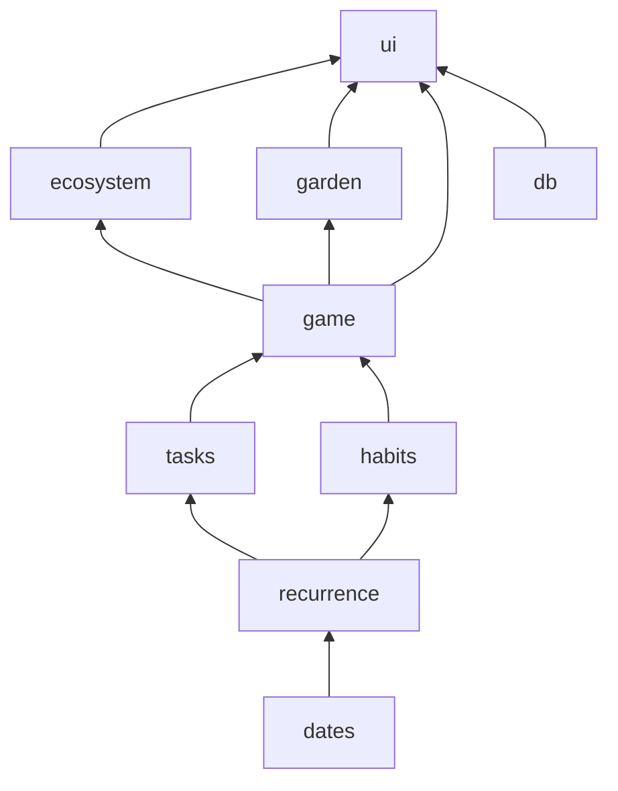

# Package layering and boundaries

All page code lives in `src/packages/<name>/` as *deep modules*: a lot of behavior behind a small interface. The decision and its alternatives are recorded in [ADR 0001](../../docs/adr/0001-modernize-typescript-deep-modules.md); the working rules are in `src/packages/README.md`. The boundaries are checked by tools, so they cannot erode by convention alone.

## Package anatomy

```
src/packages/<name>/
  index.ts        public entry point (a package may expose several root files)
  lib/            private implementation; files import each other freely
  tests/          co-located tests and fixtures (a private subfolder)
```

Packages are flat: one tier of children under `src/packages/`. A package's internals may nest; a package may not contain a package. The root files of a package are its **entry points**, the only thing other code may import. Prefer several small entry points (for example `dates/index.ts` and `dates/clock.ts`) over one barrel that re-exports a subtree. Imports use explicit `.ts` extensions.

## Layering



(An arrow means "may be imported by".) The tool-enforced rules:

- `dates` is the base layer and imports no other package; `recurrence` imports only `dates`.
- `tasks` and `habits` sit side by side: neither imports the other, and neither imports `game`.
- `game` imports the four packages below it.
- `db` is independent: it imports none of the domain packages, and they never import it.
- `ecosystem` and `garden` render game state; they may import domain packages but never `ui` or `db`.
- `ui` is the top layer: it may import every domain package, `ecosystem`, `garden` and `db`. Only `src/main.ts` imports `ui`. The game packages are reached from `ui` through dynamic `import()`, which is why they become separate bundle chunks ([Build and bundle](./build-and-bundle.md)).
- No domain package imports `ui`, `ecosystem`, `garden` or `db`.

What each package owns is summarized in [Domain logic](./domain-logic.md), [Data layer](./data-layer.md), [Board UI](./board-ui.md) and [Game derivation](../game/game-derivation.md) / [Ecosystem and Garden rendering](../game/ecosystem-and-garden.md).

## Enforcement

`pnpm lint:boundaries` runs `depcruise src` with `.dependency-cruiser.cjs`; it is part of `pnpm lint` and therefore of `pnpm verify` ([Verification and CI](../operations/verification-and-ci.md)). Every rule has severity `error`:

| Rule | Meaning |
|---|---|
| entry-point boundary (from app code) | code outside packages may import only a package's root files |
| entry-point boundary (across packages) | a package reaches other packages only through their entry points; its own files import each other freely |
| tests through entry points | files in `tests/` may import any package's entry points and their own `tests/` fixtures, never any package's `lib/` or other subfolder, not even their own |
| tests folder is private | only tests import another `tests/` folder's fixtures |
| no circular | no dependency cycles |
| layering rules | the order above |

The packages root is a single constant (`PACKAGES_ROOT`) at the top of the config; "internals" are derived from it as anything nested inside a package subfolder.

DOM and global access are not imports, so ESLint covers them: for `dates`, `recurrence`, `tasks`, `habits`, `game` and `db`, `no-restricted-globals` forbids `window`, `document`, `navigator`, `location`, `localStorage`, `sessionStorage`, `fetch` and `requestAnimationFrame`. `db` reaches the artifact db only through its `DbAdapter` seam. ESLint otherwise runs `strictTypeChecked` with `no-explicit-any` as an error, and skips `dist`, `models` (except the TypeScript tools in `models/shared/tools`), `evals/out` and all plain JS files.

## Working in the structure

- Adding a package: create the folder with root entry points, then add its layering rule to `.dependency-cruiser.cjs`, its row to the package README, and any glossary terms.
- Tests for a package call its public interface (the *seam*); see the testing guidance in [Verification and CI](../operations/verification-and-ci.md).
- Name data after its db collection in code (`buyListItems` for `buy_list_items`) and use one name per concept ([GLOSSARY.md](../../GLOSSARY.md)).
