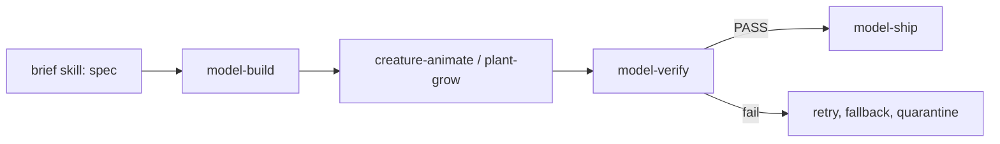

# 3D model pipeline

`models/` holds autonomous pipelines that make the 3D models the Ecosystem and Garden display ([Ecosystem and Garden rendering](../game/ecosystem-and-garden.md)). Blender runs headless (`blender -b`); no human is in the loop, and nothing ships unless every gate passes. The living, visual map is `models/pipeline.html` (regenerated by `python3 models/shared/tools/render_pipeline_map.py`); start reading at `models/README.md`, and see `docs/design/model-pipeline.md` for the design and open plan. Terms are in [GLOSSARY.md](../../GLOSSARY.md).

## Kinds

| Kind | What it is | Orchestrating skill |
|---|---|---|
| `creature` | a visiting animal, one spec to one glb with `idle`, `feed` and `sulk` clips | `weekly-visitor` |
| `plant` | one species per garden plant (a habit's plot and generation), five growth stages with `sway_<n>` loops and a `tend` reaction | `season-seeds` |
| `scenery` | a biome backdrop prop placed many times | `scenery-make` |

Each kind has `models/<kind>/{CONTRACT.md, archetypes/, specs/, qa.py, qa_calibration.json}`. A **spec** (JSON, with a `kind`) is the design; an **archetype** is a parametric Python generator for one body plan (`model`, `material`, `rig`, `animate`). Design comes first: a missing archetype is the cue to write a novel one, never a reason to drop the design. Shared code in `models/shared/` dispatches on the spec's kind.

## Stages and skills

Each step is its own skill under `.agents/skills/` so it can be re-run alone. `shared/blender/build.py` runs the Blender stages (blockout, model, topology cleanup, UVs, procedural material and texture bake, rig, animate, export a +Y-up glTF). Blender lighting exists only to make QA renders comparable; the real lighting belongs to the habitat page.

## Gates

A model must pass six gates (names appear in `report.json`, QA output and skills):

- **spec-check**: the design file is valid (`check_spec.py`).
- **shape-check**: mesh, rig, size and rest pose.
- **motion-check**: animation measured by code (loops, speed, amplitude).
- **export-check**: glb valid and small, measured on the optimized file.
- **judge-panel**: fresh AI judges score renders against the kind's golden reference.
- **page-test**: the model runs in the real habitat page in headless Chromium (automatic for creatures).

`shared/tools/verify.sh <id>` runs the code gates and renders the contact sheet: the shared structural gates, then the kind's `qa.py`. It only accepts a glb sitting in the model's `out/` folder, so QA output never lands beside a shipped asset. The judge panel is run by the `model-verify` skill.

### Judge panel and pass rule

Each judge replies with 1 to 5 scores per criterion (null for not applicable). `judge_verdict.py` is the only code that applies the rule: per criterion the median of the judges, pass when every median meets the floor and, unless the bar is null, the mean of medians meets the bar. The rule's numbers (criteria, floor, bar, judge count) live only in each kind's `qa_calibration.json` `pass_rule`; `check_judge_rule.py` fails if a doc restates them. Scenery judges look at the prop in the real habitat through the standalone `capture.html` ([Build and bundle](../architecture/build-and-bundle.md)).

## Run ledger and budget

`shared/tools/ledger.py` is the only budget counter. A run is started with a budget of judge rounds (the token cost) and wall-clock minutes. Every counted build goes through `build.py --run <id>`, and every judge reply through `ledger.py judge`, which refuses a reused judge. Exit codes: 4 budget exhausted, 5 reused judge, 6 plan needed. After a judged build the next build is refused until `plan` names the lowest-median criterion it fixes (or skips it with a reason). A polish round after a pass is capped, `best` picks the passing build to ship, and uncounted preflight trial builds keep size and motion problems from costing a counted build. Run state is in `models/out/runs/<run>.json` (gitignored).

## Failure policy

Gate failures return machine-readable reasons and the failing step retries a bounded number of times (more for novel archetypes). Still failing, the run falls back to a proven archetype with new parameters; still failing, it ships nothing that week and moves the work to `models/out/quarantine/<id>/`, with the spec moved to `<kind>/specs/quarantined/`. Every run writes `report.json` and a contact sheet for later audit.

## From model to the board

`model-ship` optimizes the glb, wraps it as base64 in a `*-glb.js` script under `models/assets/`, adds the model to `models/roster.json` (with its kind), commits on a branch and republishes the artifact ([Publishing and the weekly run](../operations/publish-and-weekly-run.md)). The page reads `roster.json` and `biomes.json` at runtime, and each entry's script sets `window.LB_CREATURES`, `LB_SCENERY` or `LB_PLANTS`; no code change is needed to show a new model. Biomes are designed by the `biome-brief` skill and checked by `check_biome.py`. Models are not built in CI; the pipeline runs locally on a Mac with Blender and `pnpm verify` only checks that the pipeline map is current ([Verification and CI](../operations/verification-and-ci.md)).

## Extension notes

- Pipeline changes (a stage, gate, judge rule or budget) update `pipeline.html` in the same commit.
- The judge model and subagent models are configured in AGENTS.md and each kind's `qa_calibration.json`; changing the judge model means re-judging each golden.
- A new kind needs a contract, archetypes, specs, `qa.py`, calibration, and a row in the shared dispatch.
