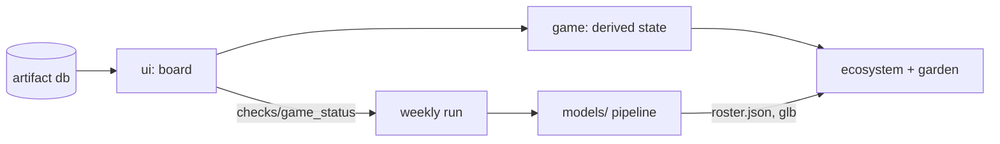

# Quickstart: where to look

Lifeboard is a personal life dashboard (tasks, habits, lists, a daily ring) published as a claude.ai Artifact with the `db` capability, plus a game layer (a garden of habit plants and a 3D Ecosystem with visitors) derived from the same data. Strict TypeScript in `src/` is bundled by esbuild into `dist/`; 3D models are produced by separate headless-Blender pipelines in `models/`. Source and tests are authoritative; this wiki is an index into them. Project terms are in [GLOSSARY.md](../GLOSSARY.md), game mechanics in [SPEC.md](../SPEC.md), and agent rules in `AGENTS.md`.

## Commands

All commands are `pnpm` scripts (never npm or yarn): `bootstrap` (first, in any fresh clone), `dev` (serve plus watch build on `PORT`, default 8765), `build`, `typecheck`, `lint`, `test`, `spec-check`, `sim`, `test:ui`, `live-diff` (drift check against the live artifact), and `verify`, which must pass before work is called done ([Verification and CI](./operations/verification-and-ci.md)).

## Which page for which task

| If you are… | Read |
|---|---|
| Changing a view, an action, an event handler or how a db change reaches the screen | [Board UI](./architecture/board-ui.md) |
| Adding or importing a package, or hitting a boundary lint error | [Package layering and boundaries](./architecture/package-boundaries.md) |
| Changing task, habit, recurrence, ring or date behavior | [Domain logic](./architecture/domain-logic.md) |
| Adding a collection, changing a schema, or debugging writes, rollback or undo | [Data layer](./architecture/data-layer.md) |
| Changing the build, bundle size, chunks, three.js loading or the dev server | [Build and bundle](./architecture/build-and-bundle.md) |
| Changing what earns what, a reward, or any number in `RULES` | [Game derivation and rules](./game/game-derivation.md) |
| Changing the 3D scene, weather, the Garden or Collection views, or URL test hooks | [Ecosystem and Garden rendering](./game/ecosystem-and-garden.md) |
| Making or fixing creatures, plants, scenery or biomes, or a gate or judge rule | [3D model pipeline](./models/model-pipeline.md) |
| Publishing, running setup, or touching the scheduled weekly job | [Publishing and the weekly run](./operations/publish-and-weekly-run.md) |
| Fixing a failing check, CI, the UI smoke test or skill evals | [Verification and CI](./operations/verification-and-ci.md) |
| Working on the macOS break overlay or break logging | [Break overlay app](./integrations/break-overlay.md) |

## Orientation

Domain packages are pure and low in the layering; `ui` is the only DOM-heavy layer and the only code `src/main.ts` imports. Game state is never stored: it is recomputed from history on load. Models reach the page only as published data (`models/roster.json`, `biomes.json`), so shipping a new creature needs no code change.

## Ground rules

- Read `AGENTS.md` and `SPEC.md` before touching game mechanics; a mechanic change updates the spec in the same commit.
- Public-safe: no home paths, real names, artifact ids or real data in tracked files; `dist/fake-db.js` and `mockdata.js` are never published.
- Changes land through pull requests with conventional commit titles; end a task with the verify, retro and `LESSONS.md` loop described in `AGENTS.md`.
